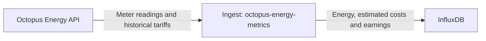

# Octopus Energy metrics: import costs and export earnings

Track the electricity you buy from the grid and sell back to it. This TypeScript
collector retrieves Octopus Energy meter readings and historical tariff rates,
then writes energy, estimated import costs, and estimated export earnings to
InfluxDB for dashboards and long-term analysis.

## High-level architecture



The collector polls Octopus, discovers electricity meters and tariffs, and
converts readings into timestamped metrics. In dry-run mode, it prints the
metrics instead of writing to InfluxDB.

## What it tracks

| Stream | Measurement | Energy and financial metrics |
| --- | --- | --- |
| Electricity import | `electricity_import` | Imported kWh, unit rate, usage cost, allocated standing charge, total cost |
| Electricity export | `electricity_export` | Exported kWh, payment rate, estimated revenue |
| Optional gas | `gas`, `gaskwh`, `gas_cost` | Raw readings, configured conversion to kWh, estimated cost |

Import and export are independent streams, not a single net reading. You can use
them to compare grid purchases and sales, track export earnings, and calculate
net grid cost over matching, fully priced intervals. Export collection is optional;
import-only and export-only operation are supported.

Electricity meter details and historical tariffs are discovered from your account.
There are no manually configured electricity rates to keep up to date. Missing
prices are reported explicitly without losing the underlying energy reading.
Gas retains its separate, manually configured conversion and pricing.

These are delayed smart-meter interval readings, **not live power telemetry**.
Grid import is not total household consumption, and grid export is not total
solar generation: self-consumed solar and battery flows require additional data.
Financial metrics are estimates, not confirmation of billing or payment.

See **[METRICS.md](./METRICS.md)** for field definitions, units, pricing rules,
safe dashboard calculations, and schema-change notes.

This is an open-source collector. Compatibility is not guaranteed; review schema
and configuration changes before upgrading. Deployment-specific retention,
archiving, and data migration policies belong in your infrastructure configuration,
not in the collector.

## Quick start

Use Node.js 26+ (`nvm use` selects 26.12.1), or Docker. Copy `.env.example` to `.env`
and configure your Octopus API key and account number:

```dotenv
OCTO_API_KEY=YOUR_API_KEY
OCTO_ACCOUNT_NUMBER=A-12345678
OCTO_EXPORT_ENABLED=true # Enable if you have an Octopus export agreement
```

Import discovery is enabled when an account or import meter setting is supplied.
Export is explicitly opt-in. Set `OCTO_ELECTRIC_ENABLED=false` for export-only
collection. Gas is disabled in the example; uncomment and configure all gas-group
settings only if you intend to collect it.

```bash
npm ci
npm run dry-run
```

### Check readings without writing to InfluxDB

Dry run fetches import/export readings and their prices once, prints Influx line
protocol and status messages, then exits,
regardless of `LOOP_TIME`. It does not contact InfluxDB or require Influx credentials.
`DRY_RUN=true` and `npm start -- --dry-run` are equivalent alternatives.

### Collect into InfluxDB

Create a destination bucket and a token with write access, then set:

```dotenv
INFLUXDB_URL=http://localhost:8086
INFLUXDB_TOKEN=YOUR_WRITE_TOKEN
INFLUXDB_ORG=YOUR_ORGANIZATION
INFLUXDB_BUCKET=octopus
```

Start regular collection:

```bash
npm start
```

The collector polls both enabled electricity directions and any configured gas
meter. `LOOP_TIME` controls the delay between polls; set it to `0` to write once
and exit. Data keeps the original reading timestamps, not the collection time.

Both commands compile TypeScript first. For a prebuilt deployment, run
`npm run build`, then `node dist/cli.js` (optionally `--dry-run`).

## Backfill all available history

With the same account, meter filters and InfluxDB settings:

```bash
npm run backfill
```

This performs a one-off backfill for every enabled stream, from an explicit
1970-01-01 lower bound to the time the run started, and follows **all reading
pages**. Octopus returns only the history it holds for the selected meter; it
does not generate readings before installation, registration, or data availability.
`PAGE_SIZE` is the batch size, not a cap on total backfilled readings.
Agreement-based prices are fetched for each batch's historical dates.

Each batch is flushed to InfluxDB before fetching the next page, limiting memory
use and retaining progress if the run fails. A summary reports reading counts,
fully priced counts, batches, and earliest/latest timestamps for each stream.
Backfill exits when finished and never enters the regular polling loop.

To preview without writes:

```bash
npm run backfill -- --dry-run
```

For Docker, use `docker compose run --rm octopus node dist/cli.js --backfill`.
`DRY_RUN=true` still disables writes; unset it or set it to `false` for a real run.
Requests use the usual per-request timeout; a multi-year backfill can take a while.
Meter filters still apply: this command does not automatically combine previous
properties or replacement meters with your selected stream.

Re-running updates matching measurement/tag/timestamps, rather than adding
cumulative events. Earlier completed batches remain if a later request or write
fails; rerun after resolving the error. Missing historical prices are logged and
energy is kept with availability flags false.

**Check the destination bucket retention before running.** InfluxDB may reject
readings older than retention; this command does not change bucket policies.
If you archive into another bucket, ensure its copy window includes the full
backfilled range, or write directly to the intended long-retention bucket.

## Electricity discovery and pricing

The account endpoint identifies import/export meter points, serial numbers and
historical tariff agreements. Optional MPAN and serial settings narrow discovery;
ambiguous results fail rather than guess. Discovery ignores moved-out and future
properties and prefers the configured/discovered import property's export supply.
Account details are refreshed every poll and shared between directions when both
use the same account.

For a separate export account accessible with the same API key:

```dotenv
OCTO_EXPORT_ACCOUNT_NUMBER=A-87654321
```

Electricity prices come **only from the API**. For each reading, the collector
uses the agreement covering the interval and fetches that tariff's rates for the
requested historical window, following rate pagination. Import uses VAT-inclusive
rates; domestic export revenue uses VAT-exclusive rates without adding VAT.
Only single-register standard-unit-rate electricity tariffs are supported.
Unsupported/ambiguous rates remain unpriced, with warnings.

Missing prices or failed price requests do not discard energy. Available financial
fields are retained and availability flags identify whether they can be used.
No zero-price or manual fallback is used. Account/readings failures and malformed
responses fail the poll; price HTTP/network/timeouts are logged and retain energy.

## Upgrading from the consumption-only schema

- Import now writes `electricity_import`, not `electricity`.
- Both directions use unit-explicit fields (`energy_kwh`,
  `unit_rate_gbp_per_kwh`, `usage_cost_gbp`/`revenue_gbp`, etc.).
- Old export `consumption` is replaced by `energy_kwh`.
- `OCTO_ELECTRIC_COST`, `OCTO_ELECTRIC_STANDING_CHARGE`, and
  `OCTO_ELECTRIC_PRODUCT_CODE` are removed. Leftover settings produce a warning
  and are ignored; remove them from `.env`. Gas pricing is unchanged.
- An account number is required for electricity pricing even with explicit
  MPAN/serial filters. Supplying the API key and account is sufficient for import.
- Update dashboards and any downstream tasks before deploying; consult the schema
  notes in [METRICS.md](./METRICS.md) for existing data. Old pricing is not
  retroactively certified or repaired by renaming fields.

## Dashboards and long-term storage

Keep the interval-level import and export streams in InfluxDB; derive daily or
monthly totals in queries rather than storing running counters. Sum energy and
interval amounts, not unit rates. Check pricing availability before summing costs
or revenue, and align coverage before subtracting export earnings from import cost.

Retention, archiving, downsampling, and historical migration are managed outside
this application. Preserve timestamps, availability flags, and field types in
downstream copies, and keep tag conventions consistent to avoid double counting.
The collector does not install Influx tasks or modify bucket retention.

Back up existing data and validate any schema transformation in an isolated bucket.
Renaming legacy fields does not revalidate their historical prices; see the
schema notes in [METRICS.md](./METRICS.md).

## Environment variables

| Variable | Requirement / default | Meaning |
| --- | --- | --- |
| `OCTO_API_KEY` | Required | API key from the Octopus dashboard |
| `OCTO_ACCOUNT_NUMBER` | For import; export fallback | Account number from bill/dashboard |
| `OCTO_ELECTRIC_ENABLED` | Defaults on if account/import settings exist | Explicit import switch |
| `OCTO_ELECTRIC_MPAN`, `OCTO_ELECTRIC_SN` | Optional | Import discovery filters |
| `OCTO_EXPORT_ENABLED` | `false` | Explicit export switch |
| `OCTO_EXPORT_ACCOUNT_NUMBER` | Optional | Account override for export |
| `OCTO_EXPORT_MPAN`, `OCTO_EXPORT_SN` | Optional | Export discovery filters |
| `OCTO_TIMEOUT_SECONDS` | `60` | Per-request timeout, positive integer |
| `PAGE_SIZE` | `48` | Readings per poll, or per batch in backfill, range 1-25000 |
| `LOOP_TIME` | `600` | Poll delay in seconds; `0` for one poll |
| `DRY_RUN` | `false` | Print once without InfluxDB |
| `INFLUXDB_URL` | Required except dry run | InfluxDB URL |
| `INFLUXDB_TOKEN` | Required except dry run | Token with write access |
| `INFLUXDB_ORG` | Required except dry run | InfluxDB organization |
| `INFLUXDB_BUCKET` | Required except dry run | Existing destination bucket |
| `OCTO_GAS_MPRN`, `OCTO_GAS_SN` | Gas group | Meter identifiers |
| `OCTO_GAS_COST` | Gas group | Manually configured gas pence/kWh |
| `VOLUME_CORRECTION` | Gas group | Gas volume correction, e.g. 1.02264 |
| `CALORIFIC_VALUE` | Gas group | Gas calorific value, e.g. 37.5 |
| `JOULES_CONVERSION` | Gas group | Gas conversion divisor, e.g. 3.6 |

All gas-group variables are required to enable gas. Gas conversion/pricing is the
legacy behavior and needs validating for your meter; see the metrics guide.
Gas support is best-effort: the current maintainer does not use gas and cannot
live-test it. Mocked regression tests help preserve existing behavior, but do not
verify real meter units, tariff accuracy, or bills.
Keys and tokens are never included in normal logs.

The timeout applies per request, not per poll: a large backload across several
tariffs can take minutes. `PAGE_SIZE` limits reading retrieval in each stream to the newest
page in normal polling; backfill follows reading pages as well as price pages. Increase the reading window if data
must be corrected after long delays.

## Docker

```bash
docker build -t repo/octopus-energy-metrics:latest .
docker compose up -d
docker compose run --rm -e DRY_RUN=true octopus
```

The final image runs as the non-root `node` user and contains only compiled
JavaScript and production dependencies. `.env` is excluded; Compose passes
configuration at runtime. The build uses reproducible `npm ci`, not `npm audit fix`.

## Development

```bash
npm ci
npm run typecheck
npm test
npm outdated
npm audit
docker build --target test -t octopus-energy-metrics:test .
docker run --rm octopus-energy-metrics:test
```

Tests use Node's built-in runner, fake Octopus responses, and a local HTTP server
for Influx writes. CircleCI tests before publishing the multi-architecture image.
Dependabot checks npm and Docker weekly.

| Location | Responsibility |
| --- | --- |
| `src/cli.ts` | Environment loading, flags, error reporting |
| `src/config.ts` | Typed, validated configuration |
| `src/octopus.ts` | Native `fetch` API access, rate pagination |
| `src/discovery.ts` | Pure meter selection |
| `src/pricing.ts` | Historical agreement and full-interval rate matching |
| `src/points.ts` | Unit-explicit Influx point conversion |
| `src/output.ts` | Dry-run output or Influx writes |
| `src/collector.ts` | Discovery/polling orchestration with asynchronous delays |
| `src/types.ts` | Shared response/domain types |
| `test/` | Tests against compiled application |
| `dist/` | Generated output, not committed |

## API sources

The [Octopus endpoint guide](https://docs.octopus.energy/rest/guides/endpoints/)
documents account discovery (`is_export`, meters, agreements), consumption and
tariff pricing. Import and export use the same consumption endpoint with different
MPANs. Product codes are extracted from agreement tariff codes, not guessed from
the product's current regional offerings.

Requests use Node's native `fetch`, with explicit timeouts and HTTP error reporting.

## Origins and licensing

This project began as a fork of
[ainsey11/octopusenergy-consumption-metrics](https://github.com/ainsey11/octopusenergy-consumption-metrics).
Thanks to the original author and contributors. The implementation has since
evolved substantially; compatibility with the original project is not guaranteed.

This project retains the ISC licence declared in the inherited package metadata;
see [LICENSE](./LICENSE) for the terms.

No standalone licence or copyright notice was found in the inspected upstream
history. The licence file was added in this fork to reflect that declaration,
with attribution based on the Git history; it is not a recovered upstream notice.
